  

<h1 align="center">Hi, I'm Wellington 👋</h1>

Software Engineering student heading toward software architecture. 
Part engineer, part writer, part game designer. I do a bit of everything, and I rarely do it the conventional way.

🇺🇸 <b>English</b> | 🇧🇷 <a href="README.pt.md">Português</a>

---

## 🚀 About me

* 🏗️ Heading toward **software architecture**. I like understanding how systems are structured, why they break, and how to design them so they hold up over time
* 🎮 Grew up wanting to make games, and I still build them. I'm drawn to the strange ones, the games that break their own genre's rules
* ✍️ Long-time reader and writer. Stories taught me what good systems also need: every part has to be there for a reason
* 🔌 Lately I've also been getting my hands dirty with **hardware**: ESP32, sensors, protoboards and a lot of jumper wires
* 🌃 Into **cyberpunk** culture and cyberdecks, which explains the banner
* 📍 Curitiba/PR, Brazil. Open to remote opportunities
* 🌎 Fluent in English and Portuguese

---

## 🧭 My path so far

**PUCPR - Software Engineering**
*2nd semester · Ongoing*

Programming logic and software engineering fundamentals with **Python, JavaScript, BPMN, UML and Git/GitHub**, plus web (HTML, CSS, Tailwind, PHP) and cyber-physical systems with **ESP32**. On my own, I'm exploring mobile development with **Flutter and Dart**.

**Universidade Positivo - Systems Analysis and Development**
*2 semesters*

Built a foundation in **C**, along with HTML, CSS and SQL, with some self-taught exposure to **C#**.

*~2 years of hands-on development across coursework and personal projects.*

---

## 🛠️ Technologies and tools

**Languages:** C · C++ · Python · JavaScript · Dart · SQL · PHP  
**Web:** HTML · CSS · Tailwind CSS · Bootstrap  
**Database:** MySQL  
**Mobile:** Flutter  
**Hardware:** ESP32 · IR and ultrasonic sensors · DFPlayer Mini  
**Design and modeling:** Figma · UML · BPMN · Astah  
**Tools:** Git · GitHub

---

## 💡 Highlighted projects

### Pausa
A mobile app to log how you're feeling in the moment and what's influencing it (work, studies, sleep, friends, love...), building a history over time for self-reflection. It started as a Figma prototype to define the UI/UX before a single line of code.

**Technologies:** Flutter, Dart, Figma  
🔗 [GitHub repository](https://github.com/WellingtonNery/pausa)  
🎨 [Figma prototype](https://www.figma.com/design/YUY5chQyRgP1jBIWEjVuNC/PAUSA?node-id=6-391&t=jn5TC6CPf6oaFKmh-1)

---

### 100 Days of Shogun
A 2D decision-based game inspired by *Reigns*. You play a shogun, and every choice shifts three interconnected variables (Satisfaction, Population and Money) over 100 days. Team project for the Algorithmic Reasoning course at PUCPR.

**My part:** the game's logic structure, the audio system, the images and the prestige system, plus the technical documentation (README).

**Technologies:** Python, Pygame  
🔗 [GitHub repository](https://github.com/WellingtonNery/100daysShogun)

---

### Bola na Rede
A goal detection system built on a small PVC soccer goal. Infrared beams wired to an ESP32 tell the ball apart from a person by how long each beam stays cut, a DFPlayer Mini plays a sound on every goal, and a live scoreboard runs on a web page served by the ESP32 itself. In the final tests it counted 20 of 21 kicks (95%). Team project for the Cyber-Physical Systems Connectivity course at PUCPR.

**My part:** sensor wiring and assembly across two protoboards, and running the test rounds used to calibrate the detection logic.

**Technologies:** ESP32, C++ (Arduino), IR sensors, HC-SR04, DFPlayer Mini  
🔗 [GitHub repository](https://github.com/JvVicente/BolaNaRede)

---

### PUC-Imprest
A team project (team OWNERS) to unify the loan process for electronic devices at PUCPR, like notebooks and ESP32 boards. In its second stage, the front end runs on a PHP backend with a MySQL database, with CRUDs for users, rooms, equipment, incidents and permissions. I built the Users CRUD (students, professors and technical staff in a single flow, with hashed passwords) and wrote the "Register return" use case. Still under development.

**Technologies:** HTML, JavaScript, Tailwind CSS, Bootstrap, PHP, MySQL  
🔗 [GitHub repository](https://github.com/WellingtonNery/Owners)  
🌐 [View website](https://wellingtonnery.github.io/Owners)

---

### Therapist Regina Olbre Prohmam
A team project developed as a real professional website for therapist Regina Olbre Prohmam. I worked on the homepage, About and Contact pages: structure, layout and responsive implementation.

**Technologies:** HTML, CSS, JavaScript  
🔗 [GitHub repository](https://github.com/diegobochnia/Regina-Olbre-Prohmam)  
🌐 [View website](https://diegobochnia.github.io/Regina-Olbre-Prohmam/)

---

## 📎 Other academic projects

Smaller coursework projects, kept for reference:

- **Pizzaria da Nonna** (HTML, CSS, JavaScript) · 🔗 [repo](https://github.com/WellingtonNery/Pizzaria-da-Nonna) · 🌐 [site](https://wellingtonnery.github.io/Pizzaria-da-Nonna/)
- **Curitiba Parks Website** (HTML, CSS) · 🔗 [repo](https://github.com/diegobochnia/ParquesDeCuritiba-BES-PUCPR-2026) · 🌐 [site](https://diegobochnia.github.io/ParquesDeCuritiba-BES-PUCPR-2026/)

---

## 📬 Contact

📧 Email: [welli.nery12@gmail.com](mailto:welli.nery12@gmail.com)  
💼 LinkedIn: [My LinkedIn profile](https://www.linkedin.com/in/wellington-nery-costa/)  
🐙 GitHub: [My GitHub profile](https://github.com/WellingtonNery)
