  

<h1 align="center">Olá, eu sou o Wellington 👋</h1>

Estudante de Engenharia de Software a caminho da arquitetura de software. 
Um pouco engenheiro, um pouco escritor, um pouco game designer. Faço de tudo um pouco, e quase nunca do jeito convencional.

🇺🇸 <a href="README.md">English</a> | 🇧🇷 <b>Português</b>

---

## 🚀 Sobre mim

* 🏗️ A caminho da **arquitetura de software**. Gosto de entender como os sistemas são estruturados, por que eles quebram e como projetá-los para que se sustentem ao longo do tempo
* 🎮 Cresci querendo criar jogos, e ainda crio. Gosto dos estranhos, dos jogos que quebram as regras do próprio gênero
* ✍️ Leitor e escritor de longa data. As histórias me ensinaram o que bons sistemas também precisam: cada parte tem que existir por um motivo
* 🔌 Ultimamente também ando colocando a mão no **hardware**: ESP32, sensores, protoboards e muito jumper
* 🌃 Curto a cultura **cyberpunk** e cyberdecks, o que explica o banner
* 📍 Curitiba/PR, Brasil. Disponível para oportunidades remotas
* 🌎 Fluente em inglês e português

---

## 🧭 Meu caminho até aqui

**PUCPR - Engenharia de Software**
*2º período · Em andamento*

Lógica de programação e fundamentos de engenharia de software com **Python, JavaScript, BPMN, UML e Git/GitHub**, além de web (HTML, CSS, Tailwind, PHP) e sistemas ciberfísicos com **ESP32**. Por conta própria, estou explorando desenvolvimento mobile com **Flutter e Dart**.

**Universidade Positivo - Análise e Desenvolvimento de Sistemas**
*2 semestres*

Construí uma base em **C**, além de HTML, CSS e SQL, com alguma experiência autodidata em **C#**.

*~2 anos de desenvolvimento prático entre projetos acadêmicos e pessoais.*

---

## 🛠️ Tecnologias e ferramentas

**Linguagens:** C · C++ · Python · JavaScript · Dart · SQL · PHP  
**Web:** HTML · CSS · Tailwind CSS · Bootstrap  
**Banco de dados:** MySQL  
**Mobile:** Flutter  
**Hardware:** ESP32 · sensores infravermelhos e ultrassônicos · DFPlayer Mini  
**Design e modelagem:** Figma · UML · BPMN · Astah  
**Ferramentas:** Git · GitHub

---

## 💡 Projetos em destaque

### Pausa
Um aplicativo mobile para registrar como você está se sentindo no momento e o que está influenciando isso (trabalho, estudos, sono, amigos, amor...), criando um histórico ao longo do tempo para reflexão pessoal. Começou como um protótipo no Figma para definir a UI/UX antes de qualquer linha de código.

**Tecnologias:** Flutter, Dart, Figma  
🔗 [Repositório no GitHub](https://github.com/WellingtonNery/pausa)  
🎨 [Protótipo no Figma](https://www.figma.com/design/YUY5chQyRgP1jBIWEjVuNC/PAUSA?node-id=6-391&t=jn5TC6CPf6oaFKmh-1)

---

### 100 Days of Shogun
Um jogo 2D baseado em decisões, inspirado em *Reigns*. Você é um xogum, e cada escolha mexe em três variáveis interligadas (Satisfação, População e Dinheiro) ao longo de 100 dias. Projeto em equipe da disciplina de Raciocínio Algorítmico da PUCPR.

**Minha parte:** a estrutura lógica do jogo, o sistema de áudio, as imagens e o sistema de prestígio, além da documentação técnica (README).

**Tecnologias:** Python, Pygame  
🔗 [Repositório no GitHub](https://github.com/WellingtonNery/100daysShogun)

---

### Bola na Rede
Um sistema de detecção de gols montado numa pequena trave de PVC. Barreiras infravermelhas ligadas a uma ESP32 diferenciam a bola de uma pessoa pelo tempo que cada feixe fica cortado, um DFPlayer Mini toca um som a cada gol e um placar ao vivo roda numa página web servida pela própria ESP32. Nos testes finais, contou 20 de 21 chutes (95%). Projeto em equipe da disciplina de Conectividade de Sistemas Ciberfísicos da PUCPR.

**Minha parte:** cabeamento e montagem dos sensores em duas protoboards, e execução das rodadas de teste usadas para calibrar a lógica de detecção.

**Tecnologias:** ESP32, C++ (Arduino), sensores infravermelhos, HC-SR04, DFPlayer Mini  
🔗 [Repositório no GitHub](https://github.com/JvVicente/BolaNaRede)

---

### PUC-Imprest
Um projeto em equipe (equipe OWNERS) para unificar o empréstimo de dispositivos eletrônicos da PUCPR, como notebooks e placas ESP32. Na segunda etapa, o front-end passou a rodar sobre um backend em PHP com banco MySQL, com CRUDs de usuários, salas, equipamentos, ocorrências e permissões. Desenvolvi o CRUD de Usuários (alunos, professores e técnicos num único fluxo, com senhas criptografadas) e escrevi o caso de uso "Registrar devolução". O projeto ainda está em desenvolvimento.

**Tecnologias:** HTML, JavaScript, Tailwind CSS, Bootstrap, PHP, MySQL  
🔗 [Repositório no GitHub](https://github.com/WellingtonNery/Owners)  
🌐 [Acessar site](https://wellingtonnery.github.io/Owners)

---

### Terapeuta Regina Olbre Prohmam
Um projeto em equipe desenvolvido como um site profissional real para a terapeuta Regina Olbre Prohmam. Trabalhei nas páginas inicial, Sobre e Contato: estrutura, layout e implementação responsiva.

**Tecnologias:** HTML, CSS, JavaScript  
🔗 [Repositório no GitHub](https://github.com/diegobochnia/Regina-Olbre-Prohmam)  
🌐 [Acessar site](https://diegobochnia.github.io/Regina-Olbre-Prohmam/)

---

## 📎 Outros projetos acadêmicos

Projetos menores desenvolvidos durante as disciplinas, mantidos como referência:

* **Pizzaria da Nonna** (HTML, CSS, JavaScript) · 🔗 [repositório](https://github.com/WellingtonNery/Pizzaria-da-Nonna) · 🌐 [site](https://wellingtonnery.github.io/Pizzaria-da-Nonna/)
* **Site dos Parques de Curitiba** (HTML, CSS) · 🔗 [repositório](https://github.com/diegobochnia/ParquesDeCuritiba-BES-PUCPR-2026) · 🌐 [site](https://diegobochnia.github.io/ParquesDeCuritiba-BES-PUCPR-2026/)

---

## 📬 Contato

📧 E-mail: [welli.nery12@gmail.com](mailto:welli.nery12@gmail.com)  
💼 LinkedIn: [Meu perfil no LinkedIn](https://www.linkedin.com/in/wellington-nery-costa/)  
🐙 GitHub: [Meu perfil no GitHub](https://github.com/WellingtonNery)
